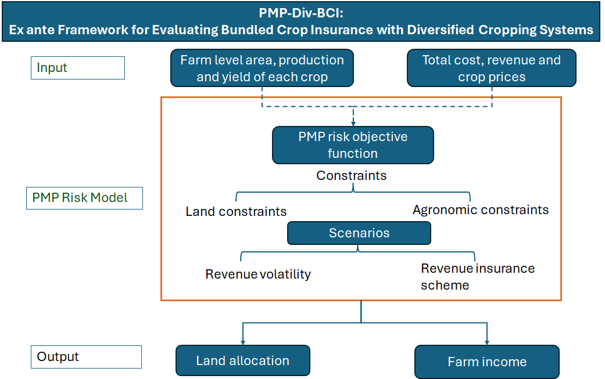

# PMPDiv-BCI: Ex ante Framework for Evaluating Bundled Crop Insurance with Diversified Cropping Systems 

PMPDiv-BCI is a positive mathematical programming tool for simulating next gen bundled crop insurance products

# Acknowledgements 
We acknowledge financial support from the People of the United States through US Government support to global food security. We also acknowledge support from the Sustainable Farming program of the CGIAR. All errors are our own.
